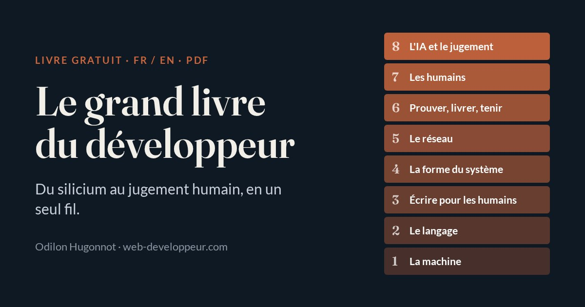

# Le grand livre du développeur

*Tout le métier en un seul fil.* · *The whole craft woven into one thread.*

La moelle de dizaines de livres tech, recousue en un seul fil pédagogique : des bits et du Big O jusqu'au code propre, l'architecture, le réseau, la livraison, les humains et l'ère de l'IA. Gratuit, en français et en anglais.

## Télécharger

| Livre | Langue | Pages | Taille |
|---|---|---|---|
| [**Le grand livre du développeur** (PDF)](https://github.com/ohugonnot/le-grand-livre-du-developpeur/releases/latest/download/le-grand-livre-fr.pdf) | Français | 182 | 5,5 Mo |
| [**The Developer's Great Book** (PDF)](https://github.com/ohugonnot/le-grand-livre-du-developpeur/releases/latest/download/le-grand-livre-en.pdf) | English | 174 | 5.2 MB |

Ces liens donnent toujours la dernière édition, celle du 9 novembre 2026 (*November 9, 2026*). Les éditions précédentes restent disponibles dans l'onglet [Releases](https://github.com/ohugonnot/le-grand-livre-du-developpeur/releases).

Envie de le lire sans télécharger ? Il est en ligne : [version française](https://www.web-developpeur.com/bibliotheque/le-grand-livre/) · [English version](https://www.web-developpeur.com/en/library/le-grand-livre/).

## Sommaire

1. La machine ne comprend que des nombres
2. Le langage, outil de pensée
3. Écrire pour les humains
4. Donner une forme au système
5. Deux machines se parlent
6. Prouver, livrer, tenir la charge
7. Le logiciel est pour des humains
8. Coder à l'ère de l'IA

## Contents

1. The machine only understands numbers
2. Language, a tool for thinking
3. Writing for humans
4. Giving the system a shape
5. Two machines talk
6. Prove it, ship it, hold the load
7. Software is for humans
8. Coding in the age of AI

## Auteur

Odilon Hugonnot, développeur web ([web-developpeur.com](https://www.web-developpeur.com)). Les PDF sont générés à partir de la version en ligne, qui fait foi : une correction y est publiée d'abord, puis ce dépôt reçoit une nouvelle édition.

© Odilon Hugonnot, tous droits réservés. Gratuit à lire et à télécharger.
